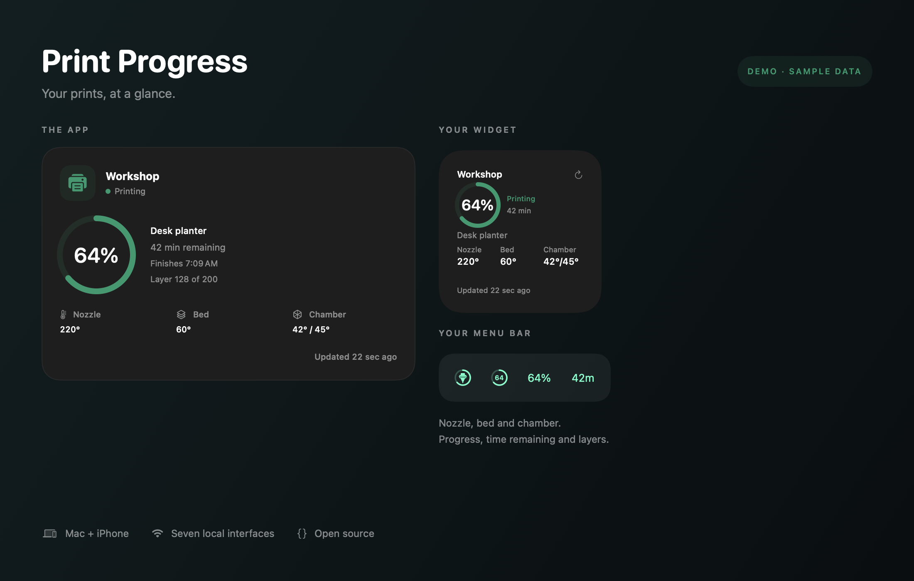

# Print Progress

A small native app and widget for checking 3D printer progress on Mac, iPhone, and iPad.

<a href="https://github.com/danielyaa5/3d-printer-widget/releases/latest/download/Print-Progress.dmg"></a>

[Website & demo](https://danielyaa5.github.io/3d-printer-widget/) · [Release notes & checksums](https://github.com/danielyaa5/3d-printer-widget/releases/latest)

**Install on Mac:** open the DMG, drag **Print Progress** to **Applications**, then open the copied app. The installer disk ejects automatically after the installed app launches. The download is a notarized Universal app for Apple silicon and Intel. If the disk is busy, it stays mounted so you can eject it later in Finder.



See percent complete, time remaining, the current job, layers, and nozzle, bed, and chamber temperatures. Chamber heat targets appear when the printer reports them. Add multiple printers and choose which one a widget shows. The Mac app also includes an optional menu bar view.

Version 0.5.1 adds Pause/Resume directly to desktop and Home Screen widgets, plus a Stop link that opens a job-specific confirmation. Version 0.5.0 added explicit **Pause**, **Resume**, and **Stop** controls to the app and Mac menu bar dropdown. Stop asks for confirmation and cancels the current job using the printer's normal cancel routine. Resume continues a paused job. It does not start a new file.

[Widget controls](docs/media/widget-controls-small.png) · [Mac controls](docs/media/mac-controls-paused.png) · [iPhone controls](docs/media/iphone-controls-paused.png) · [Stop confirmation](docs/media/iphone-controls-confirm.png)

[iPhone screen recording](docs/media/iphone-demo.mp4) · [iPhone GIF](docs/media/iphone-demo.gif) · [Illustrated overview](docs/media/demo.mp4) · [Privacy](docs/privacy.md) · [Support](docs/support.md) · [Test report](docs/testing.md)

The iPhone recording shows the actual Release app running in Simulator, switching between its built-in Printing, Paused, and Finished demo states. The 20-second illustrated overview uses production UI components. Both use fictional readings; their state changes do not represent widget refresh frequency.

[Installed Mac demo](docs/media/screenshots/mac-demo.jpg) · [Actual iPhone demo](docs/media/screenshots/iphone-demo.png) · [iPad simulator demo](release/app-store/screenshots/ipad-13-demo.png)

## Supported connections

| Printer | Connection | What you need |
| --- | --- | --- |
| Klipper printers, including a K1 Max with Moonraker installed | Moonraker HTTP/HTTPS | The Moonraker, Fluidd, or Mainsail URL, plus an API key if required |
| Bambu Lab printers, including the H2D | Local MQTT over TLS | Printer address, serial number, and LAN access code |
| Printers already connected to OctoPrint, including many Marlin / Ender setups | OctoPrint HTTP/HTTPS | Server URL and an API key with status permission |
| Prusa printers exposing PrusaLink | PrusaLink HTTP/HTTPS, modern or legacy API | Local server URL, plus its API key or local Digest username/password |
| Duet controllers running RepRapFirmware or Duet Software Framework | Duet Web Control HTTP/HTTPS | Server URL and machine password if set |
| K1 / K1 Max / K1C firmware exposing Creality’s native status service | Native WebSocket on port 9999 | `ws://printer.local:9999`; no Moonraker installation required |
| Networked SDCP v3 printers, including compatible Elegoo Saturn / Mars models | SDCP WebSocket and unicast UDP discovery | `ws://printer.local:3030/websocket`; UDP port 3000 must also be reachable |

Compatibility depends on the printer’s exposed interface and firmware, not just its brand. Many Voron and Elegoo Neptune setups work through Moonraker; many Ender and other Marlin printers work through an existing OctoPrint host. USB-only printers need a supported network host. Proprietary Anycubic cloud services, Flashforge control protocols, Creality cloud services and non-SDCP resin interfaces are not implemented. The app does not install or change printer firmware, macros or network services.

Hardware checked: Bambu H2D and K1 Max, including both Moonraker and the native Creality interface. OctoPrint, PrusaLink, Duet and SDCP connectors have automated parser/request tests and local network fixture tests, including real HTTP Digest, WebSocket and UDP exchanges. They still need validation on physical printers; no claim is made that every model or firmware has been tested.

## Setup

1. Connect your device and printers to the same network, or a VPN that provides access to the printers.
2. Open Print Progress, select **Add printer**, and choose the local interface your printer exposes. Each choice shows its address format and credential requirements.
3. Enter the connection settings. The app verifies a live status response before saving.
4. Allow local network access when the operating system asks.

New users get a walkthrough covering connection details, Local Network access, widget setup, and Mac menu bar options. Open the question-mark button to replay it anytime.

Want to look around first? Dismiss the walkthrough and choose **Explore the demo** on the empty screen, or open **Preferences → Help → Explore the demo**. Switch the sample Workshop printer between Printing, Paused, and Finished. Demo mode makes no printer requests and does not change saved printers, credentials, or widgets.

For Klipper, an example URL is `http://printer.local:7125`. Fluidd and Mainsail reverse-proxy URLs also work. For Bambu, enter a hostname such as `printer.local`, without a URL scheme or port. Find the LAN access code and serial number in the printer’s settings.

For OctoPrint, use the server URL and a key allowed to read status. For PrusaLink, use local printer credentials, separate from a Prusa Connect cloud login: API-key mode prefers the legacy API; username/password mode uses HTTP Digest and prefers the modern API. Duet supports modern object-model queries, legacy `rr_status` and SBC-mode REST. It releases only uniquely identified sessions, preserving older shared-IP Duet Web Control sessions. Native K1 monitoring listens to status messages without sending control commands. SDCP sends a discovery request to the entered printer only and requests status with command 0; it never scans the LAN or requests camera feeds.

Sensor availability depends on the interface. Missing temperatures remain unavailable. SDCP v3 print time fields are interpreted as milliseconds per its specification; printers using incompatible variants require a dedicated adapter.

On multi-nozzle Bambu printers, the nozzle reading follows the active extruder reported by the printer. It does not substitute the cooler inactive nozzle or a legacy single-nozzle field. The packed temperature and active-extruder fields follow [Bambu Studio's extruder model](https://github.com/bambulab/BambuStudio/blob/master/src/slic3r/GUI/DeviceCore/DevExtruderSystem.cpp).

### Widgets

- **Mac:** Control-click the desktop, select **Edit Widgets**, and search for **Print Progress**.
- **iPhone/iPad:** Touch and hold the Home Screen, select **Edit → Add Widget**, and search for **Print Progress**.
- **iPhone Lock Screen:** Open Lock Screen customization and select a Print Progress accessory widget.
- Edit a widget to choose a printer. With automatic selection, an active printer appears first; wider widgets show multiple printers.
- Tap the refresh arrow to open the app and get a fresh reading, or tap the widget to open the app.

Home Screen and desktop widgets show nozzle, bed, and chamber temperatures together, including a chamber heat target when reported. A missing sensor shows a dash. Small widgets keep this temperature row alongside progress, remaining time, the job name, and the last reading time.

The app refreshes approximately every 15 seconds while running. Widgets prefer recent, verified readings shared by the app. If the widget host cannot reach the local network, it keeps the real reading and its timestamp; an older reading says **Refresh needed**, rather than incorrectly declaring the printer offline. The refresh arrow opens the app because widget hosts may not have the same network access as the app.

Apple controls native widget background refreshes, so widgets do not promise continuous live progress. Every widget shows when it last updated. The timeline requests a refresh after 10 minutes during an active job and after 30 minutes when idle; the operating system can delay these requests. The iPhone app stops polling in the background. Status monitoring has no push server or required always-on bridge; the optional camera relay is a separate service.

### Mac menu bar

In **Preferences → Menu bar**, enable or disable the item and choose a progress circle, circle with percent, percent only, or time remaining. Choose a specific printer or use automatic selection to prioritize an active job. Click the item for a dropdown with full printer details, including chamber temperature.

The progress circle includes a nozzle silhouette. Every menu bar appearance, including percent and time remaining, uses the app icon’s mint and teal palette, adapting its contrast to light and dark appearances.

The dropdown shows the selected or active printer first, with complete printer cards and a scrollable list for larger fleets. It sizes to its content so the readings remain visible. Close all app windows with their red buttons or **⌘W**, or choose **Print Progress → Keep Monitoring in Menu Bar** to close them together. The Dock icon disappears while monitoring and the menu bar icon stay active. Opening the app or Settings restores the Dock icon; opening only the menu bar dropdown keeps it hidden. Choose **Quit Print Progress** to stop polling and remove the menu bar icon. A paused job shows **Paused** instead of a moving time estimate; a finished job shows **Done**.

Remaining time comes from Bambu telemetry. Klipper remaining time is estimated from elapsed printing time and reported progress, so early estimates can change substantially. Paused and offline jobs do not show a running finish time. Offline readings preserve the last known progress and its original timestamp.

Bambu reports both cancelled and failed jobs as `FAILED`. A cancellation code shows **Cancelled**; an explicit zero print-error code shows **Stopped**, since the printer has not supplied a reason. Other failures remain **Needs attention**, with the reported error code shown in the app when available. These states describe the last job, rather than diagnosing the printer’s hardware.

Moonraker chamber sensors and heaters are detected automatically. A chamber fan’s target is a cooling threshold, so it is never displayed as a heater target. Temperature readings are informational; the app does not control heating.

### Print controls

Pause, Resume, and Stop are available for Bambu LAN, Moonraker, OctoPrint, PrusaLink (modern and legacy), native Creality K1, and SDCP v3. Duet connections currently support monitoring only. Desktop and Home Screen widgets include Pause/Resume buttons. They verify the displayed job against a fresh printer reading before sending a command. Stop opens a job-specific confirmation in the app; Lock Screen accessory widgets remain informational.

Controls require a recent online reading and a known active job. The app rechecks the job before sending an action, rejects a changed or restarted job, disables repeat clicks while pending, and waits for printer status instead of inventing a paused or stopped state. Stop requires confirmation showing the printer and job. It is a normal job cancellation, not an emergency stop, and the cancelled job cannot be resumed. No command is automatically retried after an uncertain timeout.

Newer Bambu firmware may require **LAN Only → Developer Mode** for third-party controls; a saved certificate pin is also required. OctoPrint API keys need **Print** permission in addition to status access. PrusaLink v1 needs a reported job ID. Transitional, stale, offline, and unsupported states disable the controls. Protocols without a unique job ID have best-effort filename/progress checks; their APIs cannot make checking and sending atomic.

The built-in demo lets you try the buttons and Stop confirmation without contacting printers or changing live widgets. Automated controls tests use fictional loopback printers; physical printer-control validation is still pending.


## Privacy and connection trust

No account, analytics, cloud service, or subscription is required. Connection settings, access codes, API keys, certificate pins, and cached snapshots stay in the device’s shared Keychain. They are available to this app and its widget after the first device unlock; they do not sync through iCloud.

Walkthrough completion and menu bar preferences are saved locally in the app’s preferences. The privacy manifest declares this use of UserDefaults.

Bambu uses device-local TLS certificates. The first successful pairing on a trusted network records the certificate fingerprint; later connections require an exact match. If a verified firmware update changes a certificate, edit the connection and enable **Trust a replacement certificate**. Never enable that option merely to dismiss an unexplained certificate change.

Moonraker uses the protocol you enter. HTTP is unencrypted; use a trusted local network, HTTPS, or a secure VPN, and do not expose Moonraker directly to the internet.

Background monitoring remains read-only: Bambu uses `pushall`, HTTP connectors issue status/authentication GETs, native K1 monitoring is passive, and SDCP requests discovery/status. Explicit user controls separately send only pause, resume, and cancel requests. Mutation redirects are refused, and credentials and session keys are never forwarded to another origin. There are no print-start, arbitrary G-code, motion, fan, heater, firmware, or camera controls.

Protocol references: [OctoPrint](https://docs.octoprint.org/en/main/api/), [PrusaLink API specifications](https://github.com/prusa3d/Prusa-Link-Web/tree/master/spec), [RepRapFirmware HTTP API](https://github.com/Duet3D/RepRapFirmware/wiki/HTTP-requests), [Duet Software Framework REST API](https://duet3d.github.io/DuetSoftwareFramework/articles/rest-api.html), and [CBD’s SDCP v3 specification](https://github.com/cbd-tech/SDCP-Smart-Device-Control-Protocol-V3.0.0). The native K1 adapter was checked against its manufacturer-supplied local web interface and a real device.

## Build

Requires macOS 14 or iOS/iPadOS 17 or later, a recent Xcode, and [XcodeGen](https://github.com/yonaskolb/XcodeGen). There are no third-party runtime dependencies.

```sh
xcodegen generate
open PrintProgress.xcodeproj
```

Choose the `PrintProgressMac` or `PrintProgressIOS` scheme. Set your own development team and pass a unique `PRINT_BUNDLE_PREFIX` build setting for both app and widget targets. The public default is `org.example`; no account or signing identity is embedded in the project. The app and widget must share the same `PRINT_KEYCHAIN_GROUP` and signing team.

For command-line builds:

```sh
xcodebuild -project PrintProgress.xcodeproj -scheme PrintProgressMac \
  -destination 'platform=macOS' -derivedDataPath build/Mac.noindex \
  DEVELOPMENT_TEAM=YOUR_TEAM PRINT_BUNDLE_PREFIX=your.unique.prefix build

xcodebuild -project PrintProgress.xcodeproj -scheme PrintProgressIOS \
  -destination 'generic/platform=iOS' -derivedDataPath build/iOS.noindex \
  DEVELOPMENT_TEAM=YOUR_TEAM PRINT_BUNDLE_PREFIX=your.unique.prefix build
```

Regenerate icons with `swift scripts/generate-icons.swift`.

After a signed Mac build, run `bash scripts/install-macos.sh`. It installs the app in Applications, refreshes its Dock icon and widget, removes generated app copies under the project’s `.noindex` build directory, and reopens the installed app. You can pass a different built `.app` path as the first argument and a custom installation path as the second. The installer refuses to overwrite an app with a different bundle identifier.

The Mac scheme defaults to App Sandbox in both Debug and Release. For an explicit sandbox build, use `PRINT_MAC_APP_SANDBOX=YES PRINT_MAC_APP_ENTITLEMENTS=Configuration/macOS.entitlements` and omit `PRINT_PROGRESS_DIRECT`. Outgoing network access permits printer and camera connections; the app and widget use the same shared Keychain group for connection settings and snapshots. No incoming-server, shell-automation, or temporary sandbox-exception entitlement is needed for camera viewing.

After signing and again after installation, verify both bundles with:

```sh
python3 scripts/check-macos-sandbox.py "/Applications/Print Progress.app"
```

This checks signatures, App Sandbox, outgoing network access, matching resolved Keychain groups, and absence of temporary sandbox exceptions. It complements the real app checks; entitlements alone do not prove that a camera or widget works. The separately configured direct-download build remains available for installer-disk cleanup.

### Tests and live connection check

```sh
swift test --scratch-path build/Core.noindex --enable-code-coverage

xcodegen generate
xcodebuild -project PrintProgress.xcodeproj -scheme PrintProgressFeatureTests \
  -destination 'platform=macOS' -derivedDataPath build/FeatureTests.noindex \
  CODE_SIGNING_ALLOWED=NO test

swift run --scratch-path build/Core.noindex printer-probe /path/to/private-printer-settings.json
```

The core suite includes unit tests and real-socket integration tests for all seven connection families. The local fixture requires Python 3 and OpenSSL, uses only synthetic data, binds to loopback, and stops at test teardown. It exercises HTTP, Digest authentication, UDP discovery, WebSocket and TLS/MQTT, including malformed messages, certificate pinning, redirects, cancellation and deadlines. SDCP and MQTT tests report a skip if their fixed local ports are occupied; inspect skipped tests before treating a run as complete. Fixture traffic is checked for unexpected printer commands.

The native feature suite tests profile persistence, cache failures, concurrent refreshes, cancellation, late responses after editing/removing a profile, and offline recovery. It renders production SwiftUI cards, setup forms, menu bar appearances and widget layouts into `build/UIRegression.noindex`. These render checks supplement installed-app interaction tests; they do not drive the operating system's widget gallery or menu bar.

To inspect core coverage after the Swift test run:

```sh
xcrun llvm-cov report \
  build/Core.noindex/out/Products/Debug/PrintProgressCoreTests.xctest/Contents/MacOS/PrintProgressCoreTests \
  -instr-profile=build/Core.noindex/out/Products/Debug/codecov/default.profdata \
  -ignore-filename-regex='Tests/|build/'
```

The optional probe uses the same connection and parsing code as the app. Keep its settings file outside the repository and restrict its permissions; it contains credentials. Run automated tests without real printer data. Before release, also test the installed Mac and iPhone flows and physical printers: adding/editing/removing profiles, walkthrough, refresh and recovery, background behavior, menu bar, widget selection and widget-to-app links. Local fixtures cannot establish compatibility with every firmware version.

## Distribution

MIT licensed. The source is suitable for a public repository; generated builds, local signing overrides, private setup files, and generated Xcode projects are ignored. No printer details are compiled into the app.

The Mac app is available as a [direct DMG download](https://github.com/danielyaa5/3d-printer-widget/releases/latest/download/Print-Progress.dmg). Version 0.4.0 (11) was submitted to Apple for both iOS/iPadOS and native macOS on October 20, 2026. Both submissions were verified as **Waiting for Review** at submission. iPhone and iPad users can build from source while approval is pending. Submission is not approval or store availability.

The direct Mac build uses Developer ID signing and Apple's notarization. Its main app runs outside App Sandbox to identify and eject its own installer disk; the widget remains sandboxed. App Store builds retain App Sandbox and omit the installer-cleanup launch hook. Both distributions use Keychain for printer credentials, and monitoring remains read-only.

See [release preparation](docs/releasing.md) for archive, validation, and submission steps. See [CONTRIBUTING](CONTRIBUTING.md) before reporting a firmware issue or adding a connector.

## Camera previews

Each saved printer has a **Show camera** switch in its app card and Mac menu-bar card. It defaults to off, is remembered per printer in Keychain, and shares one connection between visible app and menu previews. Video stops when the last preview disappears, its window is hidden or minimized, the switch is turned off, or the printer is removed. Previews display at up to ten frames per second and are not recorded or cached. A stalled connection clears the last frame and offers Retry.

- **Klipper / Moonraker:** discovers the first enabled camera through `server/webcams/list` and applies its rotation and mirror settings. HTTP MJPEG is supported. Relative camera paths use the frontend origin; when the printer address uses Moonraker's usual API port 7125, the frontend defaults to port 80. If your frontend uses a different port, enter its full camera stream URL under **Edit connection → Camera**.
- **Bambu H2D / H2S / X1:** reads the local RTSPS H.264 stream on port 322 using the saved LAN access code. The built-in feed requires the printer's **LAN Mode Liveview** setting. Read its firmware-specific warning before enabling it, particularly if preserving cloud camera access is important. The app does not change this setting. The camera certificate is paired and saved separately from the status certificate before credentials are sent; a changed certificate is rejected. A1/P1 proprietary JPEG transport and Bambu cloud camera access are not implemented.
- **Custom Camera URL:** optionally enter an HTTP or HTTPS MJPEG stream URL under **Add printer → Camera** or **Edit connection → Camera**, for example `http://camera.invalid/webcam/?action=stream`. Leave it blank for the built-in Bambu camera or Moonraker discovery. A custom URL takes precedence over the built-in camera and is also used for widget snapshots. Video webpage links, HLS, and custom RTSP/RTSPS URLs are not supported. URLs with embedded usernames/passwords are rejected. Printer API keys are attached only to the same HTTP origin and are never forwarded through redirects.

Choose **Set up camera** on a printer card in the app or menu dropdown to compare direct local-camera access with a separately configured bridge. The setup explains the printer's possible cloud/Handy warning, tests the selected source, and enables Save only after receiving a picture. A custom source must be an HTTP or HTTPS MJPEG stream.

Print Progress only consumes the relay's MJPEG stream; it does not install relay software, automate Bambu Studio, include Bambu's networking plugin, or log in to Bambu Cloud. The optional [Bambu Studio camera bridge](docs/camera-bridge.md) runs separately and uses Studio's genuine authenticated camera export. A physical H2D feed was verified through this relay in the sandboxed Mac app while leaving the printer's local-camera setting unchanged; simultaneous Handy viewing was confirmed by the user. Availability still depends on Studio, the relay host, and the printer's firmware.

Live video is limited to the app and menu dropdown. WidgetKit widgets do not run video streams. Camera transport and decoding sources are excluded from widget targets.

### Camera snapshots in widgets

Turn on **Camera snapshots in widgets** separately for each printer in the app or menu dropdown. It defaults to off and works independently of **Show camera**. While the app is running and monitoring, it attempts a capture every 15 seconds, reduces the frame to at most 640 pixels on the longest side, and saves one JPEG and its original capture date per printer in the shared Keychain. A separate timer keeps capture independent of slow status requests, and captures never overlap for a printer. Each capture is bounded to 15 seconds and releases its camera connection when no visible live preview needs it. There is no plaintext image-cache fallback.

- **Large:** shows one opted-in printer's picture with progress, temperatures, time remaining, and available controls. Selecting a printer in widget settings selects that printer; automatic mode uses the first opted-in printer in the existing active-printer order. Without snapshot permission, the existing progress layout remains.
- **Extra-large:** shows up to two printers side by side with pictures and progress. This family is available on Mac and iPad, not iPhone.
- **Small, medium and Lock Screen:** keep their existing informational layouts and do not load camera images.

Every picture shows its actual capture age, independently of the status-update timestamp. Camera failure keeps the previous dated picture. If the app stops running, the widget keeps the saved image and its date. Widget redraws remain scheduled by the operating system; a new saved picture every 15 seconds does not guarantee a widget redraw every 15 seconds. Disabling permission deletes the saved image, and images from a replaced camera connection are never reused. The optional managed Studio relay starts video processing on request and stops its helper and decoder two seconds after the last viewer or capture disconnects. No camera image is included in logs or test reports; test fixtures use generated images.
